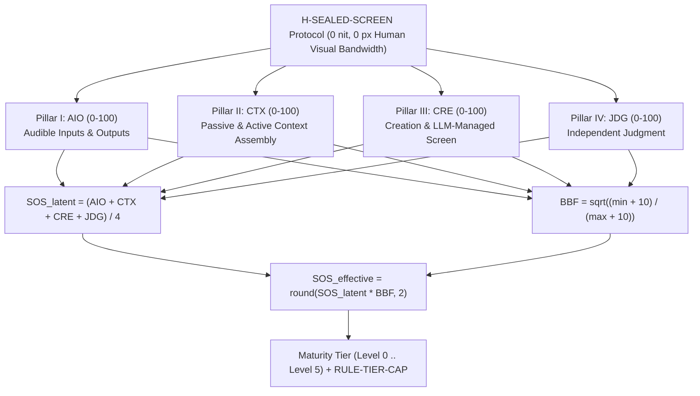

# Screen Obsolescence Score Standard (`SOS-1.0`) & Testing Suite

**Standard ID:** `SOS-STD-1.0` · **Version:** `1.0.0` · **Schema:** `sos-evaluation/1.0`

[**Read the Full Standard (`SCREEN_OBSOLESCENCE_SCORE_STANDARD.md`) →**](SCREEN_OBSOLESCENCE_SCORE_STANDARD.md)

---

## Why the Screen Obsolescence Score (`SOS`) Standard Is Important

Historically, **the scribe** embodied a full-time profession built around a single mechanical base skill: manual inscription and textual formatting. Once writing systems and reproduction infrastructure matured, exercising the mechanics of scribing ceased to be the locus of intellectual skill; human beings simply channeled intent through the medium.

Today, almost every computer-coupled activity—software engineering, scientific research, quantitative analysis, manuscript typesetting, digital art, image synthesis, and systems operations—is boxed into full-time jobs that all share one mandatory human base skill: **operating a screen**. Even when an LLM writes code or drafts text, the human operator remains tethered to a two-dimensional monitor to hunt through file trees, copy-paste context, read dense terminal logs, and visually inspect layouts, PDFs, or generated images for defects.

Thinking beyond the scribe requires recognizing that an LLM coupled with a computer generates **papers, art, images**, and executable systems. In the post-screen paradigm, the virtual screen (framebuffers, PDF rasterizers, 3D canvases, headless browsers) still exists, **but the use of the screen is 100% managed by the LLM side**.

The **Screen Obsolescence Score (`SOS-1.0`)** and its testing suite are important for four reasons:

1. **Measuring the End of Screen Mediation as a Required Base Skill:** Standard LLM benchmarks test how well a model performs *inside* a screen-bound IDE or chat window. `SOS-1.0` is the first standard to measure how completely an LLM-coupled system allows a human being to **never have to use the screen** (`H-SEALED-SCREEN`: `0 nit`, `0 px` human visual bandwidth).
2. **Exposing the Bottleneck Fallacy in "Autonomous" Systems:** A system with high internal reasoning or coding capability (`CTX`, `CRE`, `JDG`) that lacks bidirectional acoustic mediation (`AIO`) or closed-loop visual self-inspection (`CRE-3`) still forces the human back to the monitor on every turn. Through the **Bottleneck Balance Factor (`BBF`)**, `RULE-TIER-CAP`, and **Screen Fallback Event (`SFE`)** detection, this testing suite prevents headless engines from claiming post-screen autonomy when their human boundary remains screen-tethered.
3. **Enforcing Closed-Loop Machine Vision Over Visual Artifacts (`LLM-Owned Screen Loop`):** Leaving the screen behind does not mean abandoning visual creation. `SOS-1.0` requires that when a system generates a typeset paper, engineering drawing, artwork, image, or UI, the system must render that artifact to its own internal screen, inspect the pixels with machine vision and structural critics, and repair defects before reporting to the human.
4. **Preventing Epistemic and Tactical Micromanagement:** Without independent adversarial judgment (`JDG`), a screenless interface either forces the human to open a screen to verify diffs (`SFE-JDG`) or exhausts the human over audio with endless low-level confirmation prompts. `SOS-1.0` tests both epistemic self-verification and principal bandwidth conservation.

---

## Architecture of the Score



---

## Testing Tools in This Repository

All testing tools reside in [`scripts/`](scripts/) and use **Python 3.11+ standard library only** (zero external runtime dependencies).

| Tool | Purpose |
| :--- | :--- |
| [`scripts/validate_standard.py`](scripts/validate_standard.py) | Validates the normative structure of [`SCREEN_OBSOLESCENCE_SCORE_STANDARD.md`](SCREEN_OBSOLESCENCE_SCORE_STANDARD.md), verifies byte-parity with `~/SCREEN_OBSOLESCENCE_SCORE_STANDARD.md`, checks mathematical invariants, runs 20 negative/adversarial rejection tests, validates fixtures, and runs the unit test suite. |
| [`scripts/sos_engine.py`](scripts/sos_engine.py) | Core `SOS-1.0` scoring, rubric band classification, `BBF` calculation, `RULE-TIER-CAP` enforcement, `RULE-SEQ-01..RULE-TABLE-04` receipt verification, counterfactual upgrade sensitivity analyzer, and Markdown/JSON report generator. |
| [`scripts/sos_sfe_harness.py`](scripts/sos_sfe_harness.py) | `H-SEALED-SCREEN` Benchmark Simulator & **Screen Fallback Event (`SFE`)** detector across `SCN-1..SCN-5` (`SFE-IO`, `SFE-CTX`, `SFE-VIS`, `SFE-JDG`), computing Screen Fallback Rate (`SFR`) and Screen-Free Survival Rate (`SFSR`). |
| [`scripts/sos_repo_probe.py`](scripts/sos_repo_probe.py) | Automated static repository & architecture auditor that scans a target codebase across all 16 sub-dimensions, extracts `file:line` evidence locators, and emits a schema-valid `sos-evaluation/1.0` JSON receipt. |

---

## Quick Start & Verification Commands

### 1. Run the Complete Standard & Test Suite Validator

```bash
python3 scripts/validate_standard.py
```

### 2. Run the Unit Test Suite Directly

```bash
python3 -m unittest discover -s tests -v
```

### 3. Validate and Render the Magic Lab `SOS-1.0` Evaluation Report

```bash
# Validate both Native and Host-Coupled evaluation records against SCREEN_OBSOLESCENCE_SCORE_STANDARD.md
python3 scripts/sos_engine.py validate fixtures/magiclab_sos_evaluation.json --standard SCREEN_OBSOLESCENCE_SCORE_STANDARD.md

# Render the Markdown evaluation report (Native + Coupled scopes)
python3 scripts/sos_engine.py report fixtures/magiclab_sos_evaluation.json --format markdown
```

### 4. Run the Sealed-Screen Scenario Simulator (`SFE` Detector)

```bash
python3 scripts/sos_sfe_harness.py fixtures/sample_sfe_traces.json
```

*(Note: `sample_sfe_traces.json` bundles both `post_screen_sovereign_reference` (`SFR = 0.0`) and `screen_tethered_failure_showcase` (`SFR = 1.0`); pass either sub-object or inspect through `validate_standard.py`.)*

### 5. Probe a Target Repository Automatically

```bash
python3 scripts/sos_repo_probe.py /Users/pm/Documents/GitHub/magiclab --standard SCREEN_OBSOLESCENCE_SCORE_STANDARD.md
```

---

## Repository Map

- [`SCREEN_OBSOLESCENCE_SCORE_STANDARD.md`](SCREEN_OBSOLESCENCE_SCORE_STANDARD.md) — Normative `SOS-1.0` specification (synchronized with `~/SCREEN_OBSOLESCENCE_SCORE_STANDARD.md`).
- [`scripts/sos_engine.py`](scripts/sos_engine.py) — Mathematical scoring, tier-capping, receipt validation, and upgrade sensitivity engine.
- [`scripts/sos_sfe_harness.py`](scripts/sos_sfe_harness.py) — `H-SEALED-SCREEN` scenario simulator and `SFE-IO` / `SFE-CTX` / `SFE-VIS` / `SFE-JDG` detector.
- [`scripts/sos_repo_probe.py`](scripts/sos_repo_probe.py) — Automated repository evidence probe for `SOS-1.0`.
- [`scripts/validate_standard.py`](scripts/validate_standard.py) — End-to-end specification, invariant, negative-case, and fixture validator.
- [`fixtures/magiclab_sos_evaluation.json`](fixtures/magiclab_sos_evaluation.json) — Complete `SOS-1.0` evaluation bundle for Magic Lab (`native` and `coupled` scopes).
- [`fixtures/sample_sfe_traces.json`](fixtures/sample_sfe_traces.json) — Reference `SOS-BENCH-5` scenario interaction traces.
- [`tests/test_sos_suite.py`](tests/test_sos_suite.py) — Unit and integration test suite.
