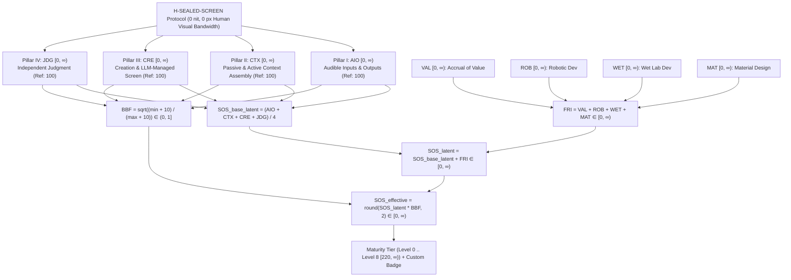

# Screen Obsolescence Score Standard (`SOS-1.0`) & Testing Suite

**Standard ID:** `SOS-STD-1.0` · **Version:** `1.0.0` · **Schema:** `sos-evaluation/1.0` · **Score Domain:** **`[0, ∞)` (No Upper Ceiling)**

[**Read the Full Standard (`SCREEN_OBSOLESCENCE_SCORE_STANDARD.md`) →**](SCREEN_OBSOLESCENCE_SCORE_STANDARD.md)


---

## Why the Screen Obsolescence Score (`SOS`) Standard Is Important

Historically, **the scribe** embodied a full-time profession built around a single mechanical base skill: manual inscription and textual formatting. Once writing systems and reproduction infrastructure matured, exercising the mechanics of scribing ceased to be the locus of intellectual skill; human beings simply channeled intent through the medium.

Today, almost every computer-coupled activity—software engineering, scientific research, quantitative analysis, manuscript typesetting, digital art, image synthesis, and systems operations—is boxed into full-time jobs that all share one mandatory human base skill: **operating a screen**. Even when an LLM writes code or drafts text, the human operator remains tethered to a two-dimensional monitor to hunt through file trees, copy-paste context, read dense terminal logs, and visually inspect layouts, PDFs, or generated images for defects.

Thinking beyond the scribe requires recognizing two truths:
1. **On a digital machine, the screen belongs to the LLM side:** A computer coupled with an LLM generates **papers, art, images**, and executable systems. In the post-screen paradigm, virtual framebuffers, PDF rasterizers, 3D canvases, and headless browsers still exist, **but the use of the screen is 100% managed by the LLM side**.
2. **There is no upper ceiling (`[0, ∞)`):** Eliminating human screen operation on a computer (`100.00` Reference Digital Baseline) is only the first threshold. An upper ceiling would imply a terminal boundary on what channeled human intent can accomplish. Once the digital screen loop is closed, the system's problem-solving horizon expands without ceiling from **ideation on a machine** $\rightarrow$ **accrual of value (`VAL`)** $\rightarrow$ **robotic development (`ROB`)** and **wet lab development (`WET`)** $\rightarrow$ **material design (`MAT`)**.

---

## Academic Metrological Badges by Maturity Level (`Level 0` to `Level 8` `[220.00, ∞)`)

Each normative level has an archival specification-plate SVG badge in [`badges/`](badges/) featuring a restrained `1.2px` orthographic/mathematical line schematic on a coordinate reticle, classical serif and tabular monospace typography, and an open-ended score interval:

| Level | Specification-Plate SVG Badge | Score Interval (`[0, ∞)`) | Horizon & Floor Requirement |
| :---: | :--- | :---: | :--- |
| **L0** |  | `0.00 – 19.99` | **Manual Screen Labor** — Direct 2D viewport operation by human |
| **L1** |  | `20.00 – 39.99` | **Assisted Screen Scribe** — Screen-tethered CLI/IDE transcription |
| **L2** |  | `40.00 – 59.99` | **Headless Cognitive Engine** — At least 2 pillars $\ge 50$; screen-tethered I/O |
| **L3** |  | `60.00 – 79.99` | **Supervised Screen-Free Delegation** — All 4 pillars $\ge 50$, `AIO >= 50`, `CRE-3 >= 13` |
| **L4** |  | `80.00 – 94.99` | **Autonomous Screen Stewardship** — All 4 pillars $\ge 75$ |
| **L5** |  | `95.00 – 119.99` | **Post-Screen Liberation (Ideation-on-Machine Closure)** — All 4 pillars $\ge 90$ |
| **L6** |  | `120.00 – 159.99` | **Autonomous Value Accrual** — All 4 pillars $\ge 90$ + `VAL >= 15` |
| **L7** |  | `160.00 – 219.99` | **Robotic and Wet-Lab Execution** — All 4 pillars $\ge 95$ + `VAL >= 20` + $\max(\text{ROB}, \text{WET}) \ge 20$ |
| **L8** |  | **`220.00 – ∞`** *(Unbounded)* | **Open-Ended Material and Physical Synthesis** — All 4 pillars $\ge 95$ + `VAL >= 25` + $\max(\text{ROB}, \text{WET}) \ge 25$ + `MAT >= 25` |

---

## Architecture of the Unbounded Score (`[0, ∞)`)



---

## Testing Tools in This Repository

All testing tools reside in [`scripts/`](scripts/) and use **Python 3.11+ standard library only** (zero external runtime dependencies).

| Tool | Purpose |
| :--- | :--- |
| [`scripts/validate_standard.py`](scripts/validate_standard.py) | Validates the normative structure of [`SCREEN_OBSOLESCENCE_SCORE_STANDARD.md`](SCREEN_OBSOLESCENCE_SCORE_STANDARD.md), verifies byte-parity with `~/SCREEN_OBSOLESCENCE_SCORE_STANDARD.md`, checks unbounded `[0, ∞)` mathematical invariants, runs negative/adversarial rejection tests, validates SVG badges & fixtures, and runs the unit test suite. |
| [`scripts/sos_engine.py`](scripts/sos_engine.py) | Core `SOS-1.0` unbounded scoring (`[0, ∞)`), Frontier Realization Horizons (`VAL`, `ROB`, `WET`, `MAT`), `BBF` calculation, `Level 0..8` + `RULE-TIER-CAP` enforcement, receipt verification, upgrade sensitivity analyzer, and Markdown/JSON report generator. |
| [`scripts/sos_badges.py`](scripts/sos_badges.py) | Custom SVG & inline ASCII design badge generator and XML validator for `Level 0` through `Level 8` (`[220.00, ∞)`) and evaluated system score badges. |
| [`scripts/sos_sfe_harness.py`](scripts/sos_sfe_harness.py) | `H-SEALED-SCREEN` Benchmark Simulator & **Screen Fallback Event (`SFE`)** detector across `SCN-1..SCN-5` (`SFE-IO`, `SFE-CTX`, `SFE-VIS`, `SFE-JDG`), computing Screen Fallback Rate (`SFR`) and Screen-Free Survival Rate (`SFSR`). |
| [`scripts/sos_repo_probe.py`](scripts/sos_repo_probe.py) | Automated static repository & architecture auditor that scans a target codebase across all 16 sub-dimensions, extracts `file:line` evidence locators, and emits a schema-valid `sos-evaluation/1.0` JSON receipt. |

---

## Quick Start & Verification Commands

```bash
# 1. Run the Complete Standard, Badge, Invariant & Test Suite Validator
python3 scripts/validate_standard.py

# 2. Generate & Validate All Custom SVG Level & System Badges
python3 scripts/sos_badges.py

# 3. Run the Unit Test Suite Directly
python3 -m unittest discover -s tests -v

# 4. Validate and Render the Magic Lab SOS-1.0 Evaluation Report
python3 scripts/sos_engine.py validate fixtures/magiclab_sos_evaluation.json --standard SCREEN_OBSOLESCENCE_SCORE_STANDARD.md
python3 scripts/sos_engine.py report fixtures/magiclab_sos_evaluation.json --format markdown

# 5. Run the Sealed-Screen Scenario Simulator (SFE Detector)
python3 scripts/sos_sfe_harness.py fixtures/sample_sfe_traces.json

# 6. Probe a Target Repository Automatically
python3 scripts/sos_repo_probe.py /Users/pm/Documents/GitHub/magiclab --standard SCREEN_OBSOLESCENCE_SCORE_STANDARD.md
```
